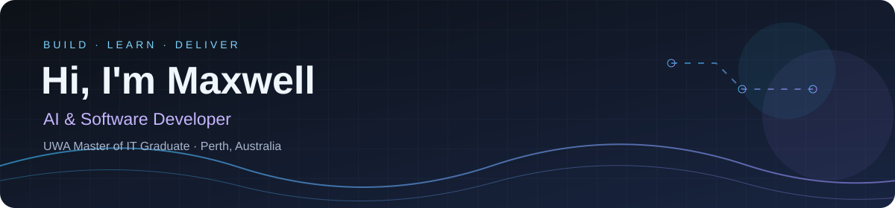

  

  

  
  
  
  

## 👋 About me

I build **LLM applications, full-stack web products and data pipelines**, from the requirement to a tested, working system. Recent work covers **local LLMs and RAG, LangChain and LangGraph orchestration, role-based business applications, and automated testing and CI**.

I hold a **Master of Information Technology, specialising in Artificial Intelligence, from the University of Western Australia**. I'm looking for graduate and junior roles in **AI application development, software engineering, data, and technical support**, where I can deliver useful systems and keep growing through real projects.

I work with AI coding agents (Claude Code and Codex) in a **harness-engineering style**. I write the specifications, rules and tests that steer the agents, then review, debug and accept each change myself, and I write part of the code by hand.

## ⚡ What I bring

- **Applied AI and LLM engineering:** RAG pipelines, local model integration through OpenAI-compatible APIs, LangChain retrievers and chat clients, LangGraph stage orchestration, structured outputs with program-side validation, and evaluation sets for each stage.
- **Full-stack product delivery:** React and TypeScript front ends, FastAPI and Flask back ends, PostgreSQL with Alembic migrations, JWT authentication and object-level role-based access control.
- **Reliability and quality:** idempotent writes, version-conflict handling, audit logs, and large automated test suites (unit, integration and Playwright end-to-end) running in GitHub Actions on every pull request.
- **Real users and support mindset:** I built and maintain a shared-house services platform that my housemates use every day, and I designed a ticketing workflow with clear roles, hand-off to a person when evidence is missing, and human-reviewed AI replies.
- **Analytical problem-solving:** comparing models, investigating errors and reporting results with clear metrics, while keeping validation and test results apart.

## 🛠️ Tech stack

### 🐍 Languages

  
  
  
  
  
  

### 💬 LLMs, RAG & Agents

  
  
  
  
  
  
  
  
  
  
  
  
  

### 🧠 Machine Learning & Deep Learning

  
  
  
  
  
  

### 📊 Data Analysis & Visualisation

  
  
  
  
  
  

### 🌐 Web & APIs

  
  
  
  
  
  
  
  
  
  
  
  
  

### 🗄️ Databases & Analytics

  
  
  
  
  
  
  
  
  

### ⚙️ Engineering & Delivery

  
  
  
  
  
  
  
  
  
  
  

### 🧰 Development & Automation

  
  
  
  
  
  
  

<strong>Algorithms, methods & engineering practices</strong>

- **LLM engineering:** retrieval-augmented generation, chunking and semantic search, structured extraction with JSON Schema, verbatim-quote and number validation, bounded retries with error feedback, state-graph orchestration, and evaluation sets per stage.
- **ML:** logistic regression, ridge regression, SVM, random forests, soft voting, PCA, GridSearchCV and Bayesian hyperparameter search.
- **Deep learning:** CNNs, MobileNetV3 transfer learning, LSTM/BiLSTM, GRU, seq2seq, VAEs, Transformer-style self-attention and attention pooling.
- **Evaluation:** train/validation/test design, cross-validation, ablation studies, confusion matrices, precision/recall/F1, PR curves, mAP and error analysis.
- **Data engineering:** ETL, star schemas, dimensional modelling, OLAP, graph modelling and FP-Growth.
- **Software delivery:** requirements analysis, user stories, object-level authorization, idempotency and audit trails, database migrations, pull requests, automated testing and CI.

## 🚀 Selected projects

### [SupportOps AI — Support Ticket & Knowledge Platform](https://github.com/Maxwell2048/supportops-ai)
**React · TypeScript · FastAPI · PostgreSQL · Docker Compose · GitHub Actions · Playwright**

A ticketing and knowledge-base platform for a fictional software support team, with AI-drafted replies that a person must review before they are sent.

- Designed the full ticket workflow for three roles (requester, agent, manager): submission, assignment, public replies and internal notes, status changes and archiving.
- Server-side authorization for every role and object; a reassigned ticket is immediately hidden from its previous agent.
- Short-lived JWT login, login rate limiting, redacted request logs, version-conflict detection, persistent idempotency and transactional audit logs. Forms keep drafts on conflict and recover safely when a write result is uncertain.
- A versioned knowledge base with permission-scoped retrieval. AI reply drafts cite their sources and go back to a person when no evidence is found.
- **299 backend tests** with no skips and **18 Playwright end-to-end flows** in desktop and narrow viewports, run in GitHub Actions against a real PostgreSQL database.

*Synthetic data and accounts; runs locally, cloud deployment planned. Built with AI coding agents. I owned the requirements, permission design, stage acceptance and part of the code.*

### [Job Application Assistant — Evidence-Grounded RAG](https://github.com/Maxwell2048/job-application-assistant)
**Python · Local LLMs · RAG · LangChain · LangGraph · FastAPI · React · GitHub Actions**

A local-first AI system that screens job ads and turns a verified personal knowledge base into evidence-linked match reports, tailored resumes, cover letters and interview preparation.

- **RAG pipeline:** JD requirement extraction, multilingual E5 retrieval over 320-token windows, and a local model judging each requirement against the evidence it retrieved.
- **Evidence-first rules enforced in code:** every generated line must quote its source verbatim, every number must exist in the source, and team results cannot be presented as personal work. Failing outputs are retried with the validation error.
- **LangChain and LangGraph:**
  - LangChain handles the local model client (`ChatOpenAI`) and a vector-store retriever.
  - LangGraph runs the generation stages as a state graph with conditional entry points, a coverage gate and checkpoints.
  - Parity tests check that both give the same results as the original implementations.
- **Web application:** FastAPI and React dashboard with a job ledger, a rate-limited job collector, fit screening, a generation queue, quality reports and step-level redo.
- **Delivery:** 500+ automated tests run on 2 operating systems × 2 Python versions, plus a frontend build, on every pull request. A labelled evaluation set reached retrieval Recall@5 14/14 and evidence judgments 22/22.

*Personal project built with AI coding agents. I owned the requirements, architecture decisions, validation rules and acceptance.*

### 99B Shared-House Platform
**Web App · Three.js · Real users**

A shared-house services platform that my housemates and I use every day, which I designed, launched and maintain as its administrator.

- Live bathroom status and booking, rent cycles, shared purchases with bill splitting and stock lists, meal voting and weekly plans, to-dos linked to a calendar, notices and a photo wall.
- An interactive 3D view of the house built with Three.js.
- I administer the platform and support my housemates in using it.

*Private repository, in daily use.*

### GeoMind — Geological Map Analysis
**YOLO · Computer Vision · Data Annotation · Docker · CI/CD**

Contributed to a five-person capstone application for extracting information from scanned geological maps.

- Annotated **57 maps** and contributed to dataset preparation and label refinement across six map-element classes.
- Trained and evaluated the detection model; the archived run reached **83.5% best validation mAP50**.
- Contributed to front-end debugging, Docker deployment testing and CI/CD operations as part of the team's development and delivery workflow.

*Collaborative capstone project; source repository is private.*

### [Finance Planner — Full-Stack Web Application](https://github.com/Dave-114-P/CITS5505-finance_planner)
**Flask · SQLAlchemy · SQLite · Bootstrap · Git**

Developed features for a team-built financial planning application, connecting database models, backend routes and user-facing pages.

- Built login and registration pages, spending estimation functionality and community sharing features.
- Implemented forum models, comments, CRUD routes and database migrations.
- Delivered changes through **30 commits** and pull-request collaboration, and supported testing and debugging.

### Natural Language Inference
**PyTorch · BoW · BiLSTM · Self-Attention · Model Evaluation**

Co-developed a two-person NLP project covering the full modelling workflow: preprocessing, model implementation, training, attention ablations, prediction export and error analysis.

- Worked across BoW, BiLSTM and Transformer-style self-attention models.
- Compared attention configurations; the best saved ablation achieved **73.75% validation accuracy on 1,303 examples**.
- Analysed attention weights, confidence distributions and high-confidence prediction errors.

### Deep Learning & Machine Learning

**TensorFlow / Keras · PyTorch · scikit-learn · Model Evaluation**

| Project | What I built and explored |
| --- | --- |
| **CNN & Transfer Learning** | Compared a custom CNN with MobileNetV3 on 12-class image classification; saved held-out test accuracy improved from **51.17% to 61.33%** on 600 images. |
| **Medical Abstract Classification** | Classified **11,550** medical abstracts into five classes with Word2Vec and BioWordVec embeddings and LSTMs; the BioWordVec model reached **63.38% validation accuracy**. |
| **Sequence Modelling & Generation** | Built GRU forecasting models and a VAE for climate time series, comparing direct, rolling and encoder–decoder predictions. |
| **Ensemble Learning & PCA** | Compared logistic regression, random forests, SVMs and soft voting; explored PCA for face classification and analysed when dimensionality reduction reduced performance. |
| **Ridge Regression & SVM** | Implemented ridge regression with NumPy and evaluated SVMs through parameter search, confusion matrices and precision–recall analysis. |

### Data Engineering & Analytics

**SQL · PostgreSQL · Neo4j · Power BI · Databricks**

- **Aviation data warehouse:** co-developed ETL, a star schema, OLAP queries, Power BI reporting and a Databricks/Delta Lake extension; data cleaning took **98,619** records to **98,073**.
- **Airline route graph:** modelled **2,795 airports, 488 airlines and 57,301 routes** in Neo4j and used Cypher for multi-hop route and network analysis.

<strong>More on GitHub</strong>

- [springboot-hello-auth](https://github.com/Maxwell2048/springboot-hello-auth): Spring Boot 3.2 login API with a Spring Security protected endpoint.
- [resume-upload-page](https://github.com/Maxwell2048/resume-upload-page): an upload-resume page implemented from a Figma design in plain HTML, CSS and JavaScript.

## 🌱 Where I'm heading

I'm most interested in **LLM applications and agent workflows, retrieval and search, practical ML systems and reliable software delivery**. Next, I want to take this work into cloud deployment, MLOps and systematic evaluation of LLM systems.

I learn unfamiliar tools quickly, communicate fluently in English and Chinese, and enjoy working through the details that turn a prototype into something people can rely on.

## 📊 GitHub activity

  

---

📍 **Perth, Western Australia** · Open to Perth-based and remote opportunities 
📫 **[Maxwell70174@outlook.com](mailto:Maxwell70174@outlook.com)**
